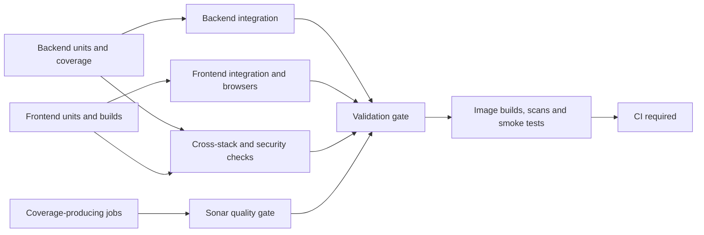

# CI stages and worker limits

Backend and frontend run as independent lanes. Each lane finishes its unit checks
before starting its integration checks. A fast frontend lane can start browser
tests while backend units are still running, and vice versa. Live API browser
tests, ZAP, and security checks wait for both unit gates.

The backend unit gate requires Python lint/types/version checks, the combined
unit report, and isolated Locust histogram contracts. The frontend unit gate
requires reader, admin, partner, and extension checks. Partner portal browser
tests run separately after frontend units, alongside the reader and admin browser
suites. Property, mutation, and browser-budget checks also follow frontend units.

Backend integration includes database tests, migration upgrades, API contracts,
fuzzing, recovery, and PR performance comparisons. Coverage-producing jobs feed
Sonar as their reports become available. The validation gate requires both
integration lanes, cross-stack checks, security, and the applicable Sonar result.
Only then can image builds begin. Tag builds use the same validation gate before
publishing release images; other events verify images without publishing.

## Worker pools

| Work                         |                 Partitions | Maximum simultaneous workers |
| ---------------------------- | -------------------------: | ---------------------------: |
| Backend unit tests           |                   4 shards |                            4 |
| Backend database integration |                   6 shards |                            4 |
| Reader browser parity        |                 6 surfaces |                            3 |
| PR performance               | 3 independent runner pairs |                            2 |

These limits apply per matrix. They do not impose an account-wide concurrency
limit. The shared image workflow owns its build matrix; staging it after
validation prevents image builds from competing with these tests.

## Complete unit coverage

Unit shards balance selected test-case counts while keeping whole files,
module fixtures, and parametrizations together. Every shard records its full
collection fingerprint, assigned node IDs, exit status, and run/SHA/attempt.
Backend tests live in nested domain packages under `tests/`; selection uses
pytest markers, and sharding discovers their paths without a flat-file allowlist.
The aggregate rejects missing, overlapping, incomplete, failed, skipped, stale,
or unmeasured shards before combining JUnit and branch coverage.
Parametrized cases that use random values or clocks need stable descriptive test
IDs so independent runners collect the same suite. Compute time-sensitive values
at execution, or freeze the clock when testing date boundaries.

The coverage minimum in `pyproject.toml` applies to the complete merged backend
measurement across all backend workspaces. A partial shard cannot pass that
minimum. The aggregate retains the canonical `python-unit-arm64-<attempt>`
artifact and report paths used by the PR coverage comment and Sonar. Raw shards
use `unit-shard-<index>-arm64-<attempt>` artifacts so Sonar consumes only the
validated aggregate, alongside integration and loadtest coverage.

The unsharded local command remains `bash scripts/ci/python-tests.sh unit`.
To reproduce CI sharding, run `bash scripts/ci/python-tests.sh unit INDEX 4`
for each index from 0 through 3, then run
`bash scripts/ci/python-tests.sh unit-merge 0 4` in the same checkout.

## Failure propagation

Stage gates reject unsuccessful or missing prerequisites. Expensive consumers
use normal success gating; report and aggregate jobs may run after failures to
explain them, but cannot promote partial results to success. Existing event rules
still determine which API, performance, quality, and release jobs apply to PRs,
merge groups, master pushes, tags, schedules, and manual runs.

`CI required` checks both stage gates and their individual required jobs, as well
as the applicable image workflow. Local validation and an older successful run do
not replace a complete hosted run for the pushed commit.
